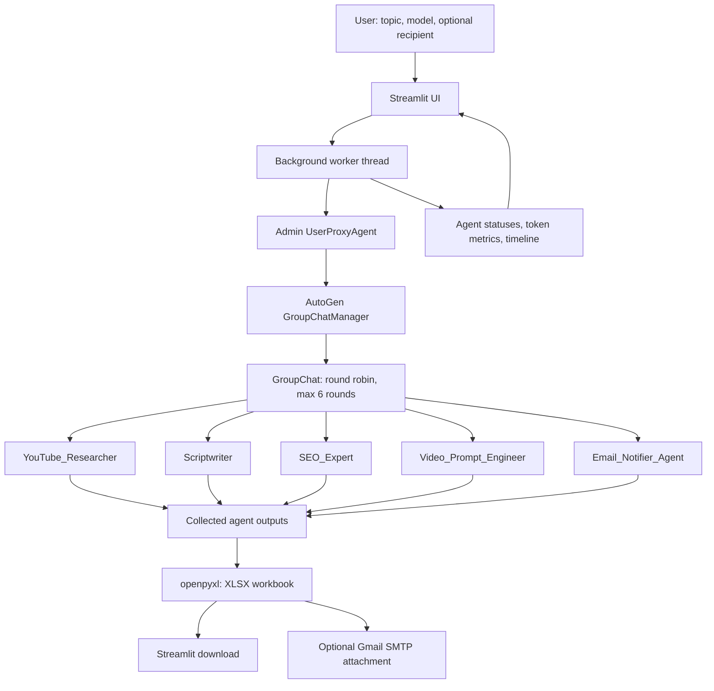

# YouTube AI Agent Studio

A Streamlit dashboard powered by **AutoGen multi-agent GroupChat** that creates a YouTube Shorts content package from a topic, tracks agent activity and token usage, exports an Excel workbook, and optionally emails the workbook through Gmail SMTP.

> Entry point: `YoutubeAgent.py`. This README describes the supplied implementation; it does not require changes to the Python file.

## Features

- Five specialized assistant agents: researcher, scriptwriter, SEO expert, SCALE video prompt engineer, and email notifier.
- AutoGen `GroupChat` coordinated by `GroupChatManager`, with `speaker_selection_method="round_robin"` and `max_round=6`.
- Streamlit live dashboard refreshing approximately every second, including agent status, responses, execution timeline, elapsed time, token metrics, reported API cost, and XLSX download.
- Excel export with an overview, individual content sheets, and a structured **SCALE Video Prompts** sheet whose fifth column stores each scene's complete JSON object.
- Optional Gmail SMTP delivery of the Excel workbook as an attachment.
- Environment-variable configuration for API and email credentials.

## Architecture



The five assistants participate in the same group conversation. The manager is configured with an LLM client and may incur additional model usage beyond what the per-agent dashboard reports.

## Implementation workflow

1. **Configure:** Set `OPENAI_API_KEY` and, if emailing, Gmail SMTP environment variables.
2. **Start:** Launch the Streamlit application and enter a topic, choose `gpt-4o-mini` or `gpt-4o`, and optionally enter a recipient email.
3. **Generate:** The app starts a background worker, initializes the AutoGen agents and group chat, and sends the topic via the `Admin` proxy agent.
4. **Collaborate:** The researcher develops three angles; the scriptwriter creates a 60-second script; the SEO agent proposes titles, description, and tags; the video prompt engineer produces nested SCALE scene JSON; and the email notifier summarizes the package.
5. **Monitor:** The dashboard displays per-agent status and output, execution events, elapsed time, token metrics, and reported cost.
6. **Export:** `openpyxl` writes the workbook to the same directory as `YoutubeAgent.py`.
7. **Deliver:** The user can download the workbook from the dashboard. If a recipient is supplied and SMTP is configured, the worker attempts to email the attachment.

## Project structure

```text
YouTube-AI-Agent-Studio/
├── YoutubeAgent.py         # Streamlit UI, AutoGen workflow, export, SMTP
├── README.md               # Project documentation
├── .env                    # Local secrets; do not commit
└── youtube_content_*.xlsx  # Generated files (created at runtime)
```

## Requirements

- Python compatible with your chosen **AutoGen classic** package and its dependencies.
- OpenAI API key with access to the selected model.
- Python packages: `streamlit`, `python-dotenv`, `openpyxl`, and **classic AutoGen** providing `from autogen import AssistantAgent, UserProxyAgent, GroupChat, GroupChatManager`.

**Important:** This source uses the classic `autogen` API, not the newer `autogen_agentchat` API. Install the compatible classic distribution:

```bash
python -m pip install --upgrade pip
python -m pip install streamlit python-dotenv openpyxl "pyautogen<0.3"
```

If your Python version cannot resolve the classic package, use a separate Python 3.11 environment. Do not install the modern `autogen-agentchat` package as a drop-in replacement for these imports.

## Setup and run

### 1. Create a virtual environment

**Windows PowerShell**

```powershell
py -3.11 -m venv .venv
.\.venv\Scripts\Activate.ps1
```

**macOS / Linux**

```bash
python3.11 -m venv .venv
source .venv/bin/activate
```

### 2. Install dependencies

```bash
python -m pip install streamlit python-dotenv openpyxl "pyautogen<0.3"
```

### 3. Create `.env`

```dotenv
OPENAI_API_KEY=your_openai_api_key
USER_EMAIL=recipient@example.com
SMTP_SENDER_EMAIL=sender@gmail.com
SMTP_APP_PASSWORD=your_google_app_password
```

`OPENAI_API_KEY` is required. `USER_EMAIL` prepopulates the recipient field. SMTP settings are needed only for email delivery. A Gmail App Password requires the appropriate Google account setup; do not use your regular Gmail password.

### 4. Run the app

```bash
python -m streamlit run YoutubeAgent.py --server.port 8501
```

Open **http://localhost:8501** in your browser.

### 5. Generate a package

Enter a topic (for example, `Authentic Tamil Nadu Chettinad Heritage`), choose a model, optionally specify an email address, and click **Generate XLSX & Email**. Watch agent responses and metrics; when the file is ready, use **Download root XLSX**.

## Agent responsibilities

| Agent | Responsibility |
|---|---|
| `YouTube_Researcher` | Suggests three content angles and research notes; instructed to distinguish verifiable facts. |
| `Scriptwriter` | Creates a 60-second YouTube Shorts script with a 10-second hook, body, and CTA. |
| `SEO_Expert` | Produces three titles, description with timestamps, and tags. |
| `Video_Prompt_Engineer` | Generates a JSON array of scenes using the SCALE schema. |
| `Email_Notifier_Agent` | Summarizes the final content package for email. |

**SCALE scene fields:** `framework`, `scene_number`, `title`, `subject`, `composition`, `action`, `location`, `time_of_day`, and `lighting`.

## Excel workbook output

The generated workbook includes:

| Worksheet | Contents |
|---|---|
| `Overview` | Topic, creation time, section-to-agent mapping. |
| `Research & Angles` | Researcher response. |
| `YouTube Script` | Scriptwriter response. |
| `SEO Metadata` | SEO agent response. |
| `Email Summary` | Email notifier response. |
| `SCALE Video Prompts` | Scene number, title, primary subject, location, and full nested scene JSON in **column E**. |

If SCALE JSON parsing fails, the raw video prompt output is written into the SCALE worksheet instead.

Example generated filename:

```text
youtube_content_2026-10-28_063200_a1b2c3.xlsx
```

The date, time, and suffix vary per run.

## Dashboard monitoring

The dashboard reports:

- Completed agents out of five, recorded agent LLM calls, prompt/completion/total tokens, elapsed time, and reported API cost.
- Individual agent statuses, durations, responses, and token usage.
- Timestamped execution events.
- A download control for the generated XLSX.

**Metrics caveat:** The implementation reads per-agent usage via `get_actual_usage()`. It does not separately measure all `GroupChatManager` calls, so displayed calls, tokens, and cost should not be treated as complete billing totals. The `calls` field is set to `1` for each successful agent reply rather than counting every underlying API request.

## Known limitations

- The researcher has **no web-search tool** in this file; it generates research-style output from the model, not independently verified live research.
- The implementation does **not** generate or upload a video. It generates scripts and structured video-generation prompts.
- Email delivery is optional; SMTP failures are printed and do not change the run's final `Completed` status.
- The dashboard's completion message may say the package was emailed even when email was omitted or SMTP delivery failed. Confirm delivery independently.
- Run state is kept in Streamlit session state and a background thread; it is not persisted to a database and is not a durable job queue.
- Agent output quality and valid SCALE JSON depend on model responses. The parser validates JSON-array syntax but not the complete SCALE schema.
- `max_round=6` limits the conversation; it is not a guarantee that every agent always completes a useful response.

## Security recommendations

Add the following to `.gitignore`:

```gitignore
.env
.venv/
__pycache__/
youtube_content_*.xlsx
```

Do not commit API keys, Gmail App Passwords, or generated workbooks containing sensitive content. For production deployment, use managed secrets, proper authentication, durable background jobs, and reliable delivery-status tracking.

## Troubleshooting

**`ModuleNotFoundError: No module named 'autogen'`** — Check that the active environment has a compatible classic `pyautogen` installation. Confirm with `python -m pip show pyautogen`.

**`No module named streamlit`** — Install packages into the same interpreter used to launch the app: `python -m pip install streamlit`.

**Missing `OPENAI_API_KEY`** — Add the key to `.env` in the working directory and restart the app.

**Email not received** — Check the recipient, `SMTP_SENDER_EMAIL`, Gmail App Password, network connectivity, and terminal output. XLSX creation can succeed even if sending fails.

**SCALE sheet contains raw text** — The model did not return a parseable JSON array; inspect the `Video_Prompt_Engineer` response in the dashboard.

## Technology stack

**Frontend:** Streamlit  
**Multi-agent orchestration:** Classic AutoGen `GroupChat` / `GroupChatManager`  
**LLM:** OpenAI (`gpt-4o-mini` or `gpt-4o`)  
**Spreadsheet:** openpyxl  
**Email:** Python `smtplib`, Gmail SMTP SSL (port 465)  
**Configuration:** python-dotenv  
**Concurrency:** Python threading
